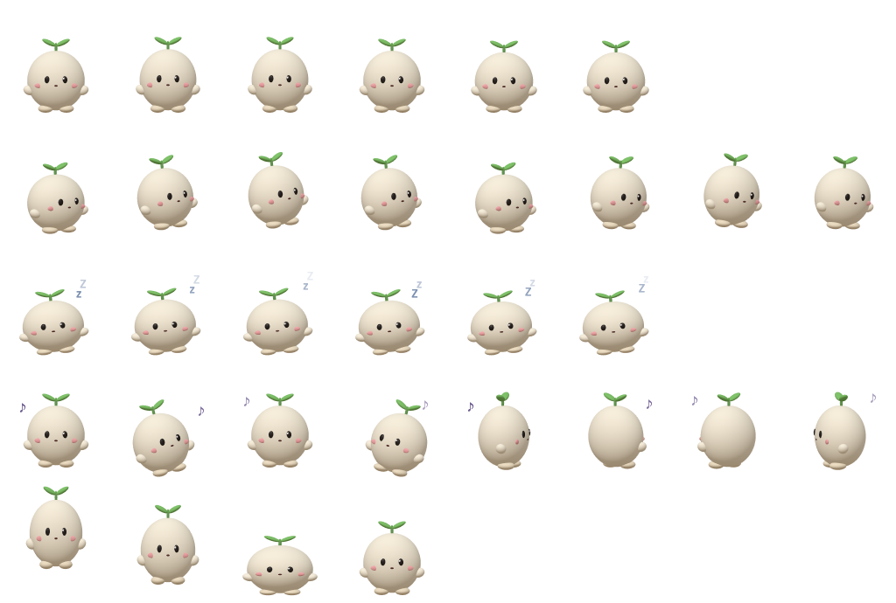

# TabPet

A tiny macOS desktop pet that walks in Chrome's tab strip (or along the Dock), dances when
music plays and dozes when you're away. Bring your own characters: make a 3D model (an AI
assistant can write one for you), turn it into a sprite sheet with the included tool, drop it in
`~/.tabpet/`. No permissions needed. The guide below is in Korean.

크롬 탭 줄(주소창 위 빈 곳)이나 Dock 위를 걸어 다니는 작은 macOS 데스크톱 펫입니다.
노래가 나오면 춤추고, 자리를 비우면 졸다가 돌아오면 반겨 줍니다. 캐릭터는 직접 만들어 넣습니다.
레포에는 예시 캐릭터 "새싹이" 하나만 들어 있습니다.



## 설치

macOS 14 이상, Apple Silicon. Xcode 없이 Command Line Tools(`xcode-select --install`)만 있으면 됩니다.

```sh
git clone https://github.com/green4849/tabpet.git
cd tabpet
sh build.sh                      # → ~/Applications/TabPet.app
open ~/Applications/TabPet.app
sh login.sh on                   # 로그인할 때 자동 실행 (끄기: sh login.sh off)
```

메뉴 막대의 발바닥 아이콘이 TabPet입니다. 한 번에 하나만 실행됩니다.

## 하는 일

| 상황 | 행동 |
|---|---|
| 평소 | 맨 앞 크롬 창의 탭 줄 빈 곳에서 천천히 걷다가 가끔 쉼. 크롬 창이 없으면 화면 아래(Dock 위) |
| 크롬 창을 옮기거나 바꿀 때 | 창을 따라가고, 다른 창에 가려진 곳은 피하고, 창이 닫히면 떨어짐. 크롬이 다른 모니터에 있으면 그쪽으로 감 |
| 크롬 창 위로 뛰어오를 때 | `hop` |
| 소리가 3초 넘게 날 때 | 춤 (시작할 때 `dance` 소리 한 번). 자기 소리 뒤 3초는 무시 |
| 키보드·마우스 입력이 5분 없을 때 | 졸기 (조는 순간 `sleep`). 돌아오면 `welcome` |
| 클릭 | `poke` |
| 끌었다 놓기 | 떨어지며 매번 `drop` |
| 전체 화면 앱(영상, 발표) | 숨고 소리도 안 냄 |

- 소리는 드물게 납니다. 아무 소리 사이 8초, 같은 소리는 2분에 한 번(`drop`만 예외).
  자리를 비운 동안에는 조는 순간의 `sleep` 말고는 소리를 내지 않습니다.
  여러 캐릭터가 떠 있어도 목소리는 하나로 묶여 있어 전체에 한 번만 적용됩니다.
- 메뉴: 화면에 캐릭터 띄우기 / 캐릭터 소리 / 캐릭터(여러 개 고를 수 있음) / 종료.
- 권한 요청이 없습니다. 소리는 "출력 장치가 쓰이는 중인가", 자리 비움은 "마지막 입력 후 몇 초"만 봅니다.
  창 정보는 위치와 앱 이름만 읽습니다(제목, 화면 녹화 없음).
- 소리 재생 기록: `/usr/bin/log show --last 10m --predicate 'eventMessage CONTAINS "pet voice"'`

### 크기와 탭 줄 맞추기

캐릭터는 그림의 75% 크기(창 48×52pt)로 뜹니다. 탭이 어디서 끝나는지는 손쉬운 사용 권한 없이는 알 수 없어서
탭 줄 높이 40pt, 왼쪽 400pt(창 버튼과 첫 탭 한두 개), 오른쪽 180pt를 비워 두고 그 사이를 걷습니다.
탭이 많으면 탭 위를 지나갈 수 있습니다. 바꾼 뒤 앱을 다시 켜세요.

```sh
defaults write io.github.green4849.tabpet tabStripLeft -float 600
defaults write io.github.green4849.tabpet tabStripRight -float 180
defaults write io.github.green4849.tabpet tabStripHeight -float 40
defaults write io.github.green4849.tabpet petScale -float 1     # 원래 크기
```

## 캐릭터 직접 만들기 (AI 활용)

TabPet의 캐릭터는 **그림 시트 한 장**(`<이름>-sheet.png` + `<이름>-sheet.json`)입니다.
`~/.tabpet/`에 넣으면 메뉴 "캐릭터"에 나타납니다. 만드는 순서는 3D 모델 만들기 → 시트로 찍기 → 넣기입니다.

### 먼저: 저작권

- **공개하거나 나눠 줄 캐릭터는 직접 만들었거나 권리가 있는 것만** 쓰세요.
- 만화·애니 캐릭터를 따라 만든 것은 팬아트라도 원작자 권리가 남습니다. 자기 컴퓨터에서만 쓰고,
  레포나 포크에 올리지 마세요. `~/.tabpet/`은 레포 밖이라 커밋되지 않습니다.
- 원작 그림에서 얼굴을 따거나 음원을 잘라 쓴 소리도 마찬가지입니다.

### 1단계. 3D 모델(.glb) 만들기

방법은 셋입니다. 어느 쪽이든 결과물은 **발이 y=0, 앞이 +z를 보는 .glb 파일**이면 됩니다.

**A. AI에게 도형 조립 스크립트를 쓰게 하기 (추천, 외부 업로드 없음)**

예시 캐릭터가 이 방법으로 만들어졌습니다: [`tools/example-character/sprout.py`](tools/example-character/sprout.py).
타원체 몇 개를 조합해 .glb를 쓰는 짧은 파이썬 스크립트입니다(numpy만 필요). AI 어시스턴트에게
이 파일을 보여 주고 이렇게 요청하면 됩니다.

> `tools/example-character/sprout.py`를 참고해서 내 캐릭터를 만드는 스크립트를 써 줘.
> 생김새: (예: 하얀 찹쌀떡 같은 둥근 머리, 작은 세모 귀 두 개, 짧은 팔다리, 파란 꼬리, 까만 점 눈, 분홍 볼).
> 발은 y=0, 앞은 +z, 머리 폭은 0.6 정도로. 부위마다 메시를 나눠 이름을 붙여 줘(head, body, armL, armR, legL, legR, tail).
> 실행하면 `<이름>.glb`가 나오게.

그려 둔 그림이 있으면 같이 보여 주세요. 얼굴처럼 세밀한 부분은 그림을 텍스처로 입히는 방식도 요청할 수 있습니다
(직접 그린 그림일 때만 공개해도 됩니다).
`python3 tools/sheet-maker/server.py`를 켠 뒤 `http://127.0.0.1:4660/sheet-maker/?model=../내폴더/이름.glb&save=0`으로
여러 각도를 확인하면서 "옆모습이 어색해", "팔을 더 짧고 통통하게"처럼 고쳐 달라고 하면 됩니다.

**B. 그림을 3D로 바꿔 주는 서비스**

직접 그린 그림 한 장을 이미지→3D 서비스(예: TRELLIS, Meshy, Tripo)에 넣어 .glb를 받습니다.
그림이 외부 서버로 올라가니 서비스 약관을 확인하세요. 결과가 무겁거나 납작하게 나오면 A 방법으로 다듬는 게 낫습니다.

**C. 공개된 3D 모델**

Sketchfab 같은 곳에서 받은 모델은 라이선스(CC-BY 등)를 확인하고, 공개할 때는 출처를 밝히세요.
기존 작품의 캐릭터를 본뜬 모델은 위 "저작권" 항목이 그대로 적용됩니다.

### 2단계. 그림 시트로 찍기

```sh
python3 tools/example-character/sprout.py tools/example-character/sprout.glb   # 예시 모델 만들기
python3 tools/sheet-maker/server.py                                              # 127.0.0.1:4660
```

브라우저에서 이 주소를 열면 시트를 찍어 `tools/sheet-maker/out/`에 저장합니다(three.js는 CDN에서 받습니다).

```
http://127.0.0.1:4660/sheet-maker/?model=../example-character/sprout.glb&name=sprout&label=새싹이
```

| 주소 뒤에 붙이는 값 | 뜻 |
|---|---|
| `model=` | .glb 경로 (`tools/` 기준) |
| `name=` | 파일 이름. 영어 소문자·숫자·`-` (`name=bean` → `bean-sheet.png`) |
| `label=` | 메뉴에 보일 이름 (없으면 `name`) |
| `turn=180` | 모델이 뒤를 보고 있을 때 돌리는 각도 |
| `bright=1.5` | 너무 어둡게 나올 때 밝히기 |
| `save=0` | 저장하지 않고 미리보기만 |

### 3단계. 넣기

```sh
mkdir -p ~/.tabpet && cp tools/sheet-maker/out/<이름>-sheet.* ~/.tabpet/
```

메뉴 "캐릭터"에서 고르면 바로 나옵니다. 여러 개를 동시에 띄울 수 있습니다.

### 더 나아가기: 상황마다 다른 자세

기본 시트 도구는 모델 전체를 튀기고 기울이고 돌리는 것만 합니다. 상황마다 다른 자세(책 읽기, 꼬리 덮고 자기,
팔 벌리고 날기 등)를 원하면 AI에게 이렇게 요청하세요. 이 레포를 만들 때 실제로 이렇게 작업했습니다.

1. **모델을 부위별로 나누기:** "머리·몸·팔·다리·꼬리를 따로 된 노드로 만들고, 각 노드의 `extras.pivot`에
   관절 위치(어깨, 엉덩이, 목, 꼬리 뿌리)를 넣어 줘."
2. **상황별 참고 그림 주기:** 상황마다 원하는 모습의 그림(직접 그린 것이나 말로 설명)을 주고 어느 상황에 쓸지 정합니다.
   예: 쉬기 = 책 읽기, 걷기 = 신나서 팔 벌리기, 자리 비움 = 탁자에서 공부, 노래 = 데굴데굴 구르기, 잡기·떨어지기 = 당황.
3. **시트 도구 고치기:** "`tools/sheet-maker/index.html`을 복사해서, 각 줄(ROWS)마다 부위별 회전(팔 각도 등),
   소품(책, 탁자, 연필처럼 three.js 도형으로), 표정(얼굴 텍스처 위에 눈·입 다시 그리기)을 바꾸게 해 줘."
4. **확인하며 다듬기:** 결과 시트를 캡처해 보면서 "팔이 머리에 가려", "옆모습이 어색해"처럼 고쳐 달라고 합니다.
   우리 경험상 팔은 몸에 붙은 짧고 통통한 모양이 작은 화면에서 잘 보입니다.

### 시트 규격

| 항목 | 값 |
|---|---|
| 한 칸 | 128×138px (화면에는 64×69pt × 75%) |
| 줄 순서 | `idle`(쉬기), `walk`(걷기, 오른쪽을 봄), `sleep`(자리 비움), `dance`(노래), `fall`(잡기·떨어지기). 다른 이름의 줄은 무시 |
| 칸 배치 | 한 줄에 최대 8칸, 왼쪽부터 |
| json | `{"cell":[128,138], "displayPoints":[64,69], "displayName":"메뉴 이름", "rows":[{"name":"idle","frames":6,"fps":6}, …]}` |
| 발 위치 | 칸 아래에서 10px 위 (바닥선) |

`fall` 줄은 0번째 칸이 들려 있을 때, 1번째가 떨어질 때, 2·3번째가 착지할 때 쓰입니다.

### 소리

동작마다 소리 하나씩입니다. `~/.tabpet/sounds/`에 같은 이름의 짧은 소리(m4a·wav·mp3·aiff·caf)를 넣으면
예시 소리 대신 씁니다. `poke-1.m4a`, `poke-2.m4a`처럼 번호를 붙이면 그중 하나를 고르고, 없는 소리는 건너뜁니다.

| 파일 이름 | 언제 | 예시 소리 |
|---|---|---|
| `poke` | 클릭 | 작은 두 음 "삑뿍" |
| `drop` | 끌었다 놓을 때 | 내려가는 "퓨"와 착지 "통" |
| `hop` | 크롬 창 위로 뛰어오를 때 | 올라가는 "뿅" |
| `welcome` | 자리 비웠다 돌아올 때 | 밝은 세 음 인사 |
| `dance` | 노래가 시작될 때 | 짧은 신나는 멜로디 |
| `sleep` | 졸기 시작할 때 | 천천히 내려가는 작은 한숨 |

예시 소리는 [`tools/example-character/sounds.py`](tools/example-character/sounds.py)가 사인파로 만든 칼림바 같은 소리입니다
(녹음·샘플 없음). 숫자를 바꿔 음높이나 길이를 고칠 수 있습니다.

## 폴더

| 경로 | 내용 |
|---|---|
| `Sources/` | 앱 (Swift, AppKit) |
| `characters/` | 앱에 함께 들어가는 예시 캐릭터와 소리 |
| `tools/example-character/` | 예시 캐릭터 모델과 소리를 만드는 스크립트 |
| `tools/sheet-maker/` | .glb를 그림 시트로 찍는 페이지와 로컬 서버 |
| `~/.tabpet/` | 내 캐릭터와 소리 (레포 밖) |

## 라이선스

MIT. 예시 캐릭터 "새싹이"의 그림과 소리도 이 레포에서 직접 만든 것이라 같은 라이선스입니다.
